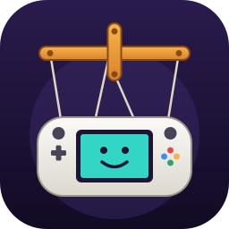
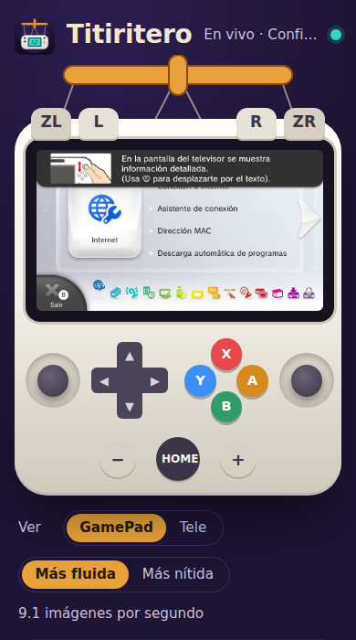
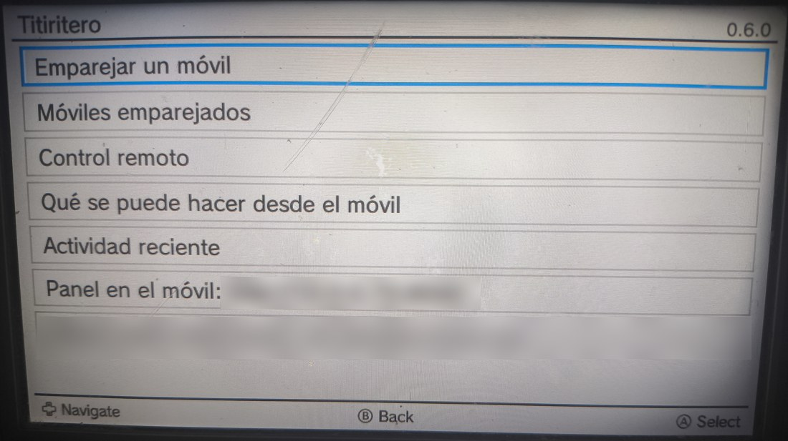
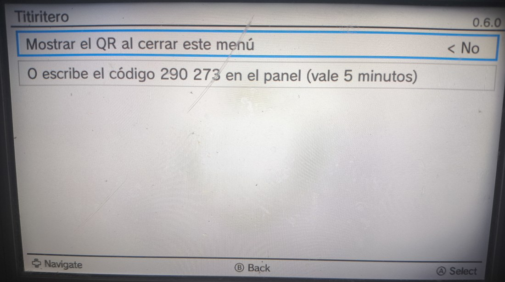
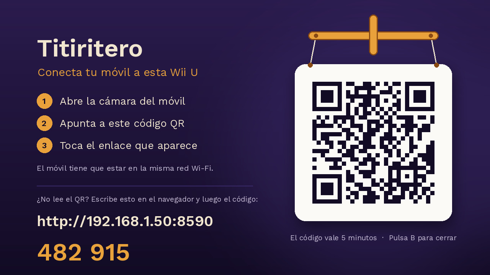
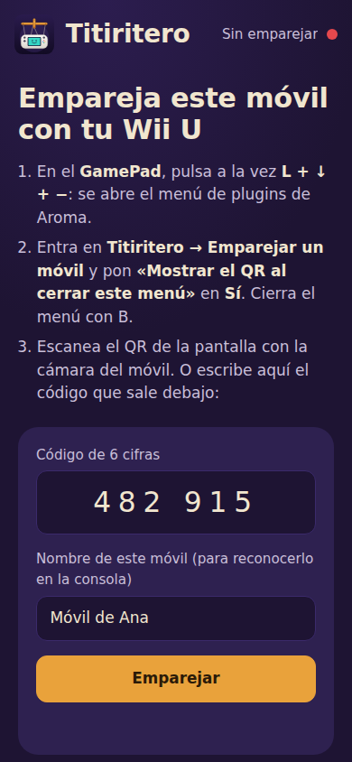
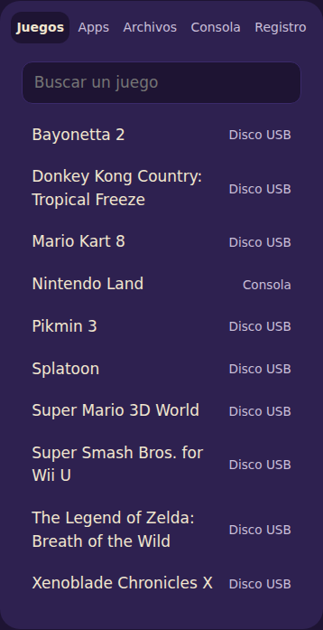
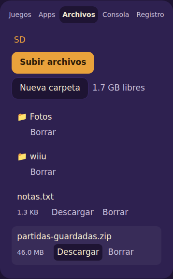
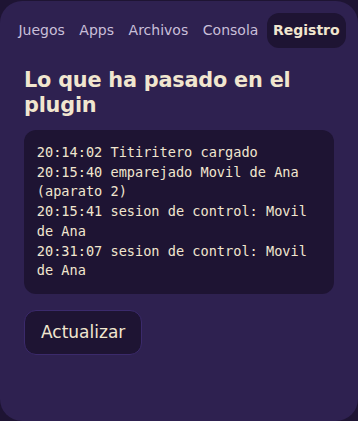
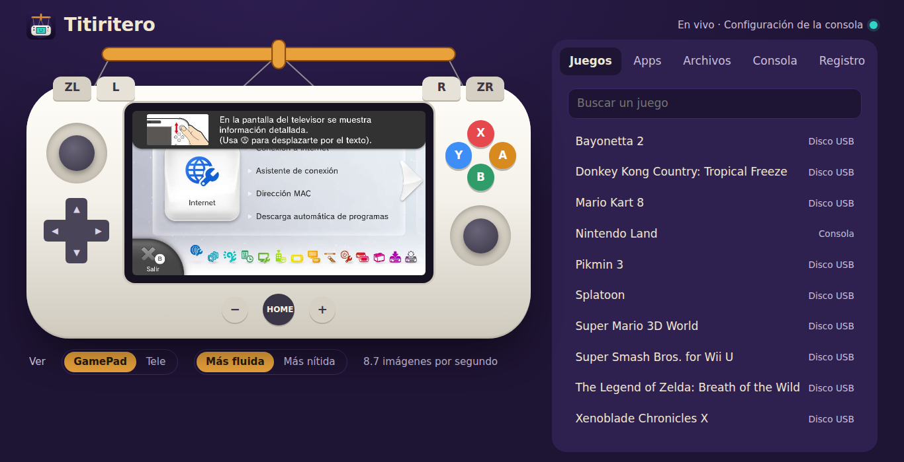

<p align="center"></p>

<h1 align="center">Titiritero</h1>

<p align="center"><b>Maneja tu Wii U desde el móvil.</b><br>
Ves la pantalla del GamePad en el móvil, pulsas sus botones, abres juegos y pasas archivos a la tarjeta SD.<br>
Sin instalar nada en el móvil y sin ordenador: solo el navegador.</p>

---

## Qué puedes hacer

<p align="center"></p>

- **Ver el GamePad en directo** en el móvil, o lo que sale en la tele.
- **Pulsar cualquier botón y tocar la pantalla**, como si tuvieras el GamePad en la mano.
- **Abrir juegos y aplicaciones** desde una lista, buscándolos por el nombre.
- **Pasar archivos** del móvil a la tarjeta SD de la consola y al revés.
- **Encontrar el GamePad** cuando se pierde entre los cojines: lo hace vibrar.
- **Mandar un mensaje** que sale en la pantalla de la consola («¡A cenar!»).
- **Volver al menú, reiniciar o apagar** la consola.

Sirve también para ayudar a alguien a distancia en la misma casa, o para manejar la consola cuando el GamePad está sin batería.

## Qué necesitas

- Una **Wii U con [Aroma](https://aroma.foryour.cafe/)** (el sistema casero para ejecutar aplicaciones y plugins).
- Un **móvil, tableta u ordenador** con navegador, conectado **al mismo Wi‑Fi** que la consola.

No hace falta ninguna app en el móvil, ni cuenta, ni servidor, ni internet.

## Instalarlo

1. Descarga **`titiritero.wps`** de la página de [versiones (Releases)](../../releases/latest).
2. Apaga la consola y saca la tarjeta SD.
3. Copia el archivo en esta carpeta de la tarjeta:
   ```
   wiiu/environments/aroma/plugins/
   ```
4. Vuelve a meter la tarjeta y enciende la consola.

Al arrancar sale un aviso arriba de la pantalla: **«Titiritero listo»**.

## Conectar el móvil (solo la primera vez)

Cada móvil se conecta una vez. Después entra solo.

**1. Abre el menú de plugins en la consola.** Pulsa a la vez **L + ↓ + −** en el GamePad. Elige **Titiritero**.

<p align="center"></p>

**2. Pide el código.** Entra en **Emparejar un móvil**, pon **Mostrar el QR al cerrar este menú** en **Sí** y cierra el menú con **B**.

<p align="center"></p>

Al cerrar el menú, en la tele y en el GamePad aparece esta pantalla:

<p align="center"></p>

**3. Escanéalo con la cámara del móvil** y toca el enlace que aparece. El móvil se conecta solo y abre el panel.

¿El móvil no lee el QR? Escribe en su navegador la dirección que sale en la pantalla (por ejemplo `http://192.168.1.50:8590`) y después el código de seis cifras:

<p align="center"></p>

El código vale **5 minutos** y **solo sirve una vez**. Para quitar la pantalla del QR, pulsa **B** en el GamePad.

> **Consejo:** en el navegador del móvil, usa «Añadir a pantalla de inicio». Así Titiritero queda como una app más.

## Usar el panel

Arriba está el **GamePad**: la pantalla se ve en directo y todos los botones funcionan. Toca la pantalla dibujada para tocar la del GamePad.
Debajo puedes elegir si ves el **GamePad** o la **tele**, y si prefieres la imagen **más fluida** o **más nítida**.

Más abajo hay cinco pestañas:

| Juegos | Archivos | Registro |
|:---:|:---:|:---:|
|  |  |  |
| Toca un juego para abrirlo. Arriba hay un buscador. | Las carpetas de la tarjeta SD. Puedes subir archivos desde el móvil, descargarlos, crear carpetas y borrar. | Lo último que ha pasado: quién se ha conectado y cuándo. |

- **Apps**: como Juegos, pero con las aplicaciones caseras de la tarjeta SD.
- **Consola**: batería del GamePad, espacio libre en la tarjeta, volver al menú, reiniciar, apagar (hay que mantener el botón pulsado, para que no se apague sin querer), hacer vibrar el GamePad, mandar un mensaje, conectar otro móvil y desconectar este.

<p align="center"></p>

En un ordenador también puedes usar el teclado: flechas para la cruceta, Intro para A, Retroceso para B, y el resto de letras como sale en pantalla.

## El menú del plugin en la consola

En el menú de plugins (**L + ↓ + −** → **Titiritero**) decides qué se puede hacer desde el móvil:

- **Pausar el control remoto**: corta todo al momento. También con **L + R + −** sin abrir el menú.
- **Avisos**: que salga un mensaje en la consola cuando alguien se conecta.
- **Imágenes por segundo**: más fluido en el móvil o menos carga para la consola mientras juegas.
- **Permisos**: puedes apagar por separado ver la pantalla, pulsar botones, abrir juegos, apagar la consola, mensajes y archivos.
  Los archivos empiezan en **«Solo ver y descargar»**. Para subir y borrar desde el móvil, cámbialo a «Ver, subir y borrar»
  (ojo: con eso un móvil conectado podría instalar plugins, que es tanto como manejarlo todo).
- **Móviles conectados**: la lista de móviles con permiso. Para quitar uno, ponlo en **Quitar** y cierra el menú.

## ¿Es seguro?

- **Solo funciona dentro de tu Wi‑Fi.** Desde internet no se puede llegar a la consola.
- **Nadie puede conectarse sin ver la pantalla de la consola**: hace falta el código, que solo sale ahí, caduca a los 5 minutos y se anula tras 5 intentos fallidos.
- **Cada móvil tiene su propia llave**, que se crea al conectarlo y **nunca viaja por el Wi‑Fi**. Cada orden va firmada con ella: aunque alguien la vea pasar, no puede repetirla ni cambiarla.
- **Puedes quitar un móvil cuando quieras** desde el menú de la consola, o pausarlo todo con **L + R + −**.
- Las llaves no se pueden leer ni cambiar desde el panel.

Lo que conviene saber:

- La conexión con el móvil **no va cifrada** (como casi todo dentro de casa). Conecta los móviles **solo en el Wi‑Fi de tu casa**, no en uno público o compartido con desconocidos.
- Quien tenga un móvil conectado puede hacer todo lo que permitas en el menú. **Conecta solo móviles de confianza**, y si alguno se pierde, quítalo de la lista.
- Si usas el plugin **ftpiiu**, apágalo cuando no lo necesites: deja leer toda la tarjeta SD a cualquiera de la red, sin contraseña.

## Problemas frecuentes

**El móvil dice que no encuentra la consola.**
Comprueba que el móvil está en el mismo Wi‑Fi que la Wii U (no en datos móviles) y que la consola está encendida. Si la dirección de la consola ha cambiado, abre el menú del plugin: ahí sale la actual.

**«No hay código activo».**
El código caducó o ya se usó. Vuelve a pedirlo en el menú del plugin.

**La imagen va a tirones.**
Elige «Más fluida» en el panel. En el menú del plugin puedes subir las imágenes por segundo (gasta algo más a la consola).

**La pestaña de la tele no muestra nada.**
Si la tele está apagada o se juega solo en el GamePad, la consola no manda imagen a la tele. Usa la vista del GamePad.

**No veo el menú de plugins al pulsar L + ↓ + −.**
Pulsa los tres botones a la vez y mantenlos un momento. Debes estar en Aroma (si al arrancar sale «Titiritero listo», lo estás).

**Quiero empezar de cero.**
En el menú del plugin quita todos los móviles. En el móvil, en la pestaña Consola, pulsa «Olvidar este móvil».

---

## Para quien quiera compilarlo

No hace falta para usarlo. Necesitas Docker, Python 3 y Pillow. Después:

```sh
./compilar.sh
```

El resultado queda en `plugin/titiritero.wps`. Las herramientas de la Wii U van en una imagen de Docker fijada por versión exacta (`Dockerfile`).

## Créditos y licencia

Titiritero es software libre con licencia **GPL-3.0** (archivo [LICENSE](LICENSE)).
Usa trabajo de otras personas, recogido en [AVISOS.md](AVISOS.md): el método de captura de pantalla de ScreenshotWUPS,
el generador de QR de Project Nayuki y la fuente Work Sans, entre otros.

Proyecto independiente, sin relación con Nintendo. Wii U y GamePad son marcas de Nintendo.
